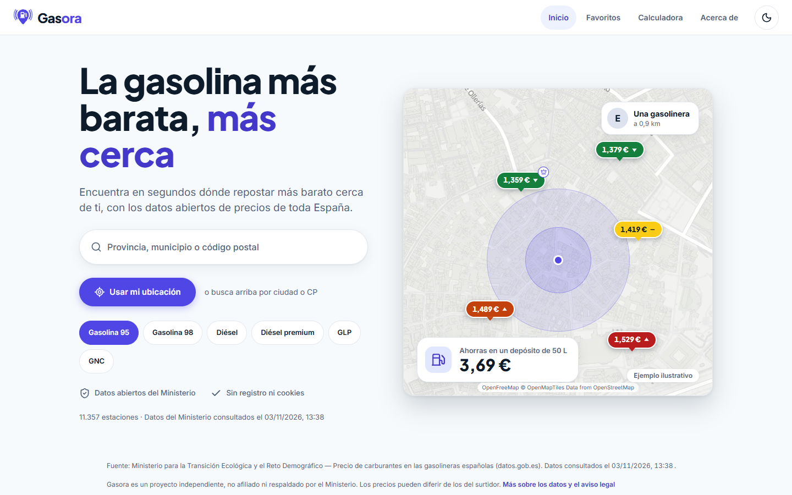
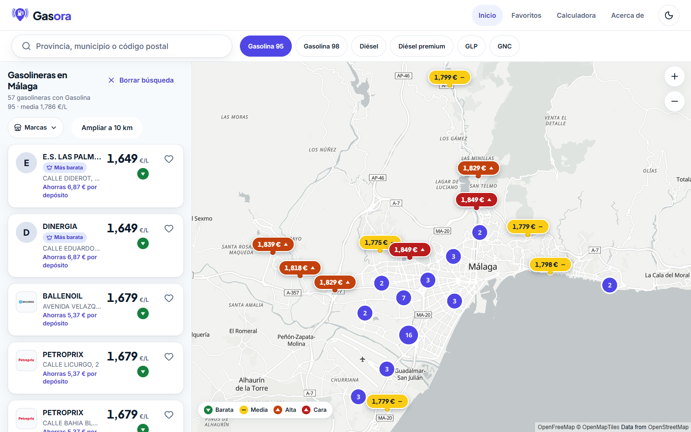
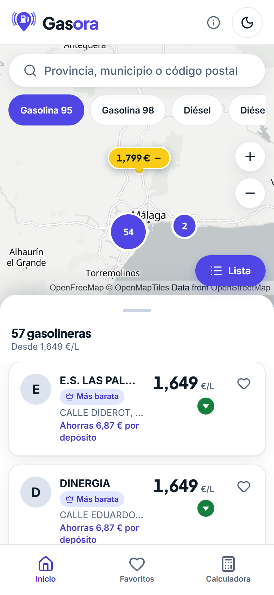
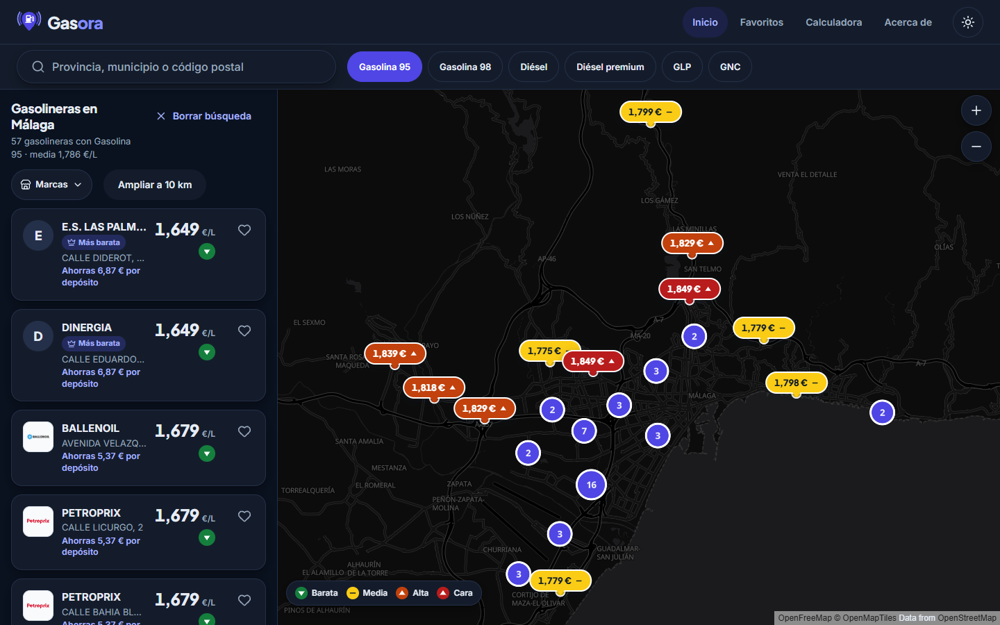
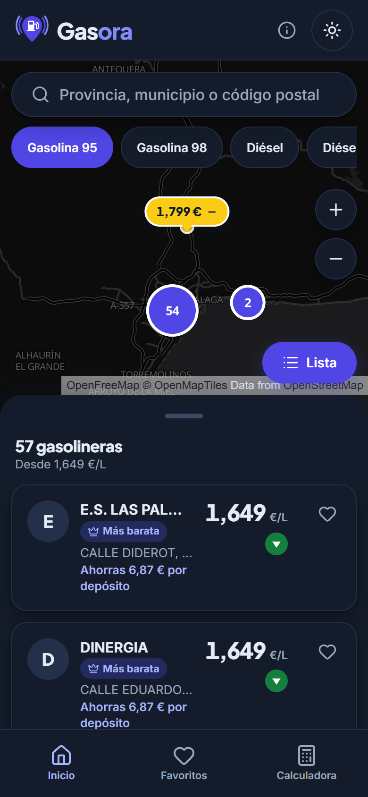
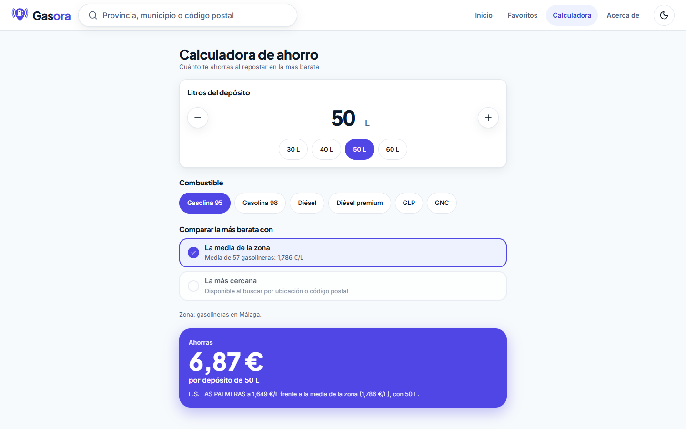
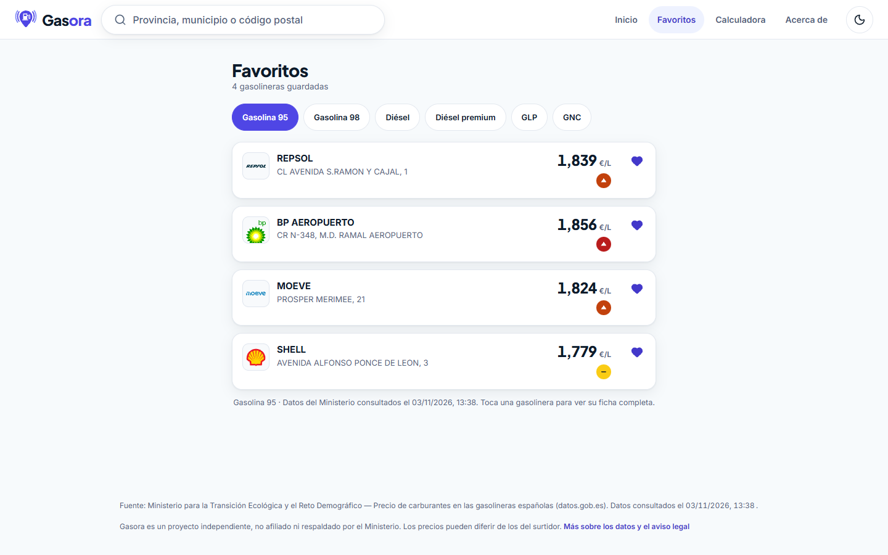
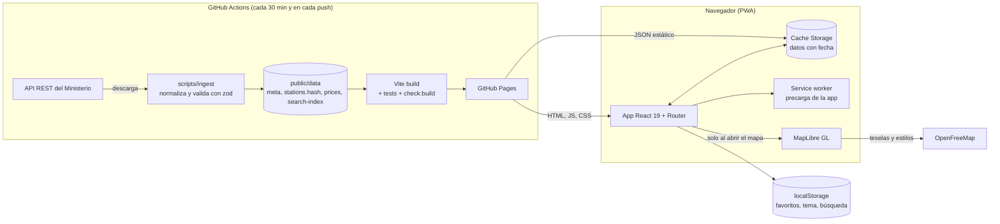

# Gasora

**La gasolina más barata, más cerca.**

Gasora es una web app (PWA) gratuita y sin registro para conductores de España. Responde a una sola pregunta, «¿dónde repostar más barato cerca de mí ahora mismo?», con los datos abiertos de precios de carburantes del Ministerio para la Transición Ecológica y el Reto Demográfico. Es un proyecto personal y de portfolio: sin servidor propio, sin cuentas, sin cookies ni analítica, y con un coste de alojamiento de 0 €.

**Web:** <https://gasora.es/> (alojada en GitHub Pages con dominio propio) · **Instalarla:** <https://gasora.es/instalar>



## Qué hace

- Busca por provincia, municipio o código postal (con autocompletado y manejo por teclado) o con «Usar mi ubicación».
- Compara seis combustibles; ordena por precio o distancia; filtra por radio y por marca.
- Marca cada precio como barato, medio, alto o caro respecto a su zona, y calcula cuánto se ahorra en un depósito.
- Muestra los resultados en lista y en mapa (MapLibre + OpenFreeMap), con hoja inferior en móvil que se repliega a una línea mientras se explora el mapa.
- Con la pestaña abierta, avisa «Hay precios nuevos · Actualizar» cuando cambian los datos, sin recolocar la lista que se está viendo.
- «Buscar en esta zona»: al mover el mapa fuera del área buscada, un botón recalcula los resultados para lo que se ve, sin red y sin cambiar combustible, orden ni marcas.
- Guarda favoritos en el dispositivo, incluye una calculadora de ahorro y URL compartibles de cada búsqueda y de cada estación.
- Se instala como aplicación, funciona sin conexión con los últimos datos guardados (avisando de su fecha) y se actualiza sola.
- Tema claro (por defecto) y oscuro; accesible por teclado y con lectores de pantalla.

|                              Resultados en escritorio                              |                           Resultados en móvil                            |
| :--------------------------------------------------------------------------------: | :----------------------------------------------------------------------: |
|  |  |
|  |  |

|                            Calculadora                            |                           Favoritos                           |
| :---------------------------------------------------------------: | :-----------------------------------------------------------: |
|  |  |

Capturas tomadas el 04/11/2026 con la web compilada y los datos reales del Ministerio consultados el 03/11/2026 a las 13:38 (hora de España); los precios que se ven son los de ese momento. Se regeneran con `npm run screenshots` (Playwright).

## Arquitectura



Principios:

- **Sin backend.** La ingesta se ejecuta en GitHub Actions: descarga el listado del Ministerio, lo normaliza y valida, y publica cuatro ficheros JSON junto con la web. El navegador nunca llama al Ministerio.
- **Datos pensados para el navegador.** Ficheros separados por uso (`stations.{hash}` con caché larga, `prices` pequeño y fresco, `search-index` que solo se baja al buscar) y validación ligera en el cliente (la ingesta ya valida todo).
- **Carga por trozos.** Pantallas, resultados, mapa y la capa de datos son trozos aparte (`lazy`); el mapa solo se descarga al mostrarlo.
- **Estado en el cliente.** Stores de `zustand` para búsqueda, datos, favoritos y tema; el estado de la búsqueda también vive en la URL.

Estructura del repositorio:

```
.github/workflows/   ci.yml (calidad) y deploy.yml (ingesta + despliegue a GitHub Pages)
docs/                decisions/ (ADR), licencias-y-atribuciones.md, capturas y mediciones
fixtures/            muestra real recortada de la API del Ministerio
public/brands/       logos de marcas (no están bajo la licencia MIT)
scripts/             ingesta (ministry, normalize, brands, validate…), iconos, capturas, comprobaciones
src/                 la app: app/ (router, shell), components/ui/, features/, lib/, stores/, pwa/, styles/
tests/               unit/ (Vitest) y e2e/ (Playwright)
```

## Decisiones técnicas

Resumen de los registros de decisiones (ADR) de [`docs/decisions/`](docs/decisions/):

| ADR                                                                                             | Decisión                                                                                                                                                |
| ----------------------------------------------------------------------------------------------- | ------------------------------------------------------------------------------------------------------------------------------------------------------- |
| [001](docs/decisions/001-fecha-de-los-datos.md)                                                 | El campo `Fecha` de la API es la hora de la consulta, no la de actualización de los precios: la web dice «consultados el…».                             |
| [002](docs/decisions/002-sin-chip-e10.md), [003](docs/decisions/003-sin-gasolina-95-premium.md) | Seis combustibles; se dejan fuera E10 (0,25 % de estaciones) y los productos con poca cobertura.                                                        |
| [004](docs/decisions/004-coordenadas-defectuosas.md)                                            | Las estaciones con coordenadas inservibles se descartan y se registran, no se «corrigen».                                                               |
| [005](docs/decisions/005-formato-de-datos-e-ingesta.md)                                         | Formato de datos y reglas de la ingesta: si los datos no son válidos no se publica y la web sigue con el último despliegue bueno.                       |
| [006](docs/decisions/006-versiones-y-herramientas.md)                                           | Dependencias con versión exacta.                                                                                                                        |
| [007](docs/decisions/007-atribuciones-y-limites-de-uso.md)                                      | Atribuciones y límites de uso de OpenFreeMap y del Ministerio.                                                                                          |
| [008](docs/decisions/008-sistema-de-diseno-y-diferencias-con-design.md)                         | Sistema de diseño con tokens, claro y oscuro.                                                                                                           |
| [009](docs/decisions/009-tarjeta-de-resultado-anti-solape.md)                                   | La tarjeta de resultado no se solapa a ningún ancho (320–1440 px, texto al 200 %); se verifica midiendo cajas.                                          |
| [010](docs/decisions/010-tema-claro-por-defecto.md)                                             | Tema claro por defecto, sin seguir al sistema.                                                                                                          |
| [011](docs/decisions/011-capa-de-datos-busqueda-y-ubicacion.md)                                 | Capa de datos, búsqueda, ubicación y privacidad (la ubicación nunca va a la URL).                                                                       |
| [012](docs/decisions/012-mapa-y-hoja-inferior.md)                                               | MapLibre con carga diferida y hoja inferior en móvil.                                                                                                   |
| [013](docs/decisions/013-favoritos-calculadora-ficha-y-url.md)                                  | Favoritos, calculadora, ficha y URL compartible.                                                                                                        |
| [014](docs/decisions/014-pwa-sin-conexion-teclado-y-rendimiento.md)                             | PWA con actualización que no deja a nadie en una versión vieja, teselas acotadas, teclado y rendimiento.                                                |
| [015](docs/decisions/015-logos-de-marcas.md)                                                    | Logos de marcas como icono de la estación, con avatar de respaldo.                                                                                      |
| [016](docs/decisions/016-omitir-despliegue-y-aviso-de-precios-nuevos.md)                        | La ingesta no compila ni despliega si los datos publicados ya son iguales (huella de contenido) y la web avisa «Hay precios nuevos» sin recolocar nada. |
| [017](docs/decisions/017-dominio-propio-gasora-es.md)                                           | Dominio propio gasora.es: la web vive en la raíz, razones, alternativas y cómo se revierte                                                              |
| [018](docs/decisions/018-pagina-de-instalacion-y-seleccion-de-marcas-en-movil.md)               | Página /instalar (pasos verificados en fuentes oficiales, ver docs/fuentes-instalacion.md) y selector de marcas modal en móvil                          |

## Calidad y métricas

Cómo se verifica: en lugar de «mirar» la interfaz, los tests de Playwright miden cajas (sin solapes ni desbordes, zonas táctiles de 44 × 44 px) con datos extremos, y axe comprueba la accesibilidad, en claro y oscuro, de 320 a 1440 px.

| Métrica                                                        | Valor                                                                                                                                                                                                                                                                                                        |
| -------------------------------------------------------------- | ------------------------------------------------------------------------------------------------------------------------------------------------------------------------------------------------------------------------------------------------------------------------------------------------------------ |
| Tests unitarios (Vitest)                                       | 250                                                                                                                                                                                                                                                                                                          |
| Tests de navegador (Playwright)                                | 1257 (36 omitidos: Tab en WebKit, texto al 200 % emulado en escritorio y a ≤ 360 px; ≈ 22 min con `CI=true`): Chromium (todo), Firefox y WebKit (layout, accesibilidad, teclado e instalación), el iPhone 11 Pro emulado (selector de marcas y vista móvil) y la PWA y los enlaces profundos con la base `/` |
| Lighthouse móvil (Inicio, Favoritos, Calculadora, «Acerca de») | rendimiento 97–100 (Inicio, Favoritos y Calculadora 100); accesibilidad, buenas prácticas y SEO: 100                                                                                                                                                                                                         |
| Lighthouse móvil (`/instalar`)                                 | rendimiento 95–96; accesibilidad, buenas prácticas y SEO: 100                                                                                                                                                                                                                                                |
| Lighthouse móvil (ficha de estación)                           | rendimiento 93–97; accesibilidad, buenas prácticas y SEO: 100                                                                                                                                                                                                                                                |
| JS inicial                                                     | ≈ 271 KB (≈ 85 KB gzip); el mapa (≈ 1,1 MB, ≈ 294 KB gzip) se carga aparte                                                                                                                                                                                                                                   |
| Lighthouse móvil (resultados con mapa)                         | rendimiento 67–69 (el bloqueo del hilo principal, de 1,9 a 2,6 s con la CPU simulada a 4×, lo domina la evaluación del mapa; [ADR 014](docs/decisions/014-pwa-sin-conexion-teclado-y-rendimiento.md)); accesibilidad 98; buenas prácticas y SEO: 100                                                         |
| Datos (11.357 estaciones)                                      | estaciones 1,9 MB (≈ 411 KB gzip), precios 446 KB (≈ 80 KB gzip), índice de búsqueda 661 KB (≈ 156 KB gzip, solo al buscar)                                                                                                                                                                                  |
| Cookies y servidores ajenos                                    | ninguno salvo `tiles.openfreemap.org` (lo comprueba un test)                                                                                                                                                                                                                                                 |
| `npm audit` (solo producción)                                  | 0 vulnerabilidades                                                                                                                                                                                                                                                                                           |

## Requisitos y desarrollo

- Node.js 22 o superior (desarrollado con 24). Windows, macOS o Linux; los scripts funcionan con PowerShell.

```powershell
npm ci
npm run ingest            # descarga datos reales del Ministerio (≈12 MB, unos 5 s)
npm run dev               # http://localhost:5173 (incluye la galería /ui-kit)
npm run build
npm run preview           # http://127.0.0.1:4173
npm run ingest:fixtures   # sin conexión: datos de demostración
```

| Script                                                  | Qué hace                                                                                                                                                                                |
| ------------------------------------------------------- | --------------------------------------------------------------------------------------------------------------------------------------------------------------------------------------- |
| `npm run dev`                                           | Servidor de desarrollo de Vite                                                                                                                                                          |
| `npm run build` / `npm run preview`                     | Compila y sirve el build de producción                                                                                                                                                  |
| `npm run build:e2e`                                     | Build para los tests: incluye `/ui-kit` y unos datos de prueba deterministas (`scripts/e2e-data.ts`)                                                                                    |
| `npm run icons`                                         | Regenera los iconos de la app, el favicon y la imagen para compartir a partir de `public/favicon.svg`                                                                                   |
| `npm run hero-map`                                      | Regenera el fondo de mapa (claro y oscuro) de la ilustración del inicio con OpenFreeMap                                                                                                 |
| `npm run screenshots`                                   | Genera las capturas de este README (`docs/screenshots/`) con Playwright sobre la web real                                                                                               |
| `npm run brands:check`                                  | Valida los logos de `public/brands/` y lista las marcas sin logo                                                                                                                        |
| `npm run compare:published`                             | Usada por la ingesta: compara los datos nuevos con los publicados y decide si hay que compilar y desplegar                                                                              |
| `npm run licenses`                                      | Genera `public/licencias-de-terceros.txt` (se publica con la web) y lista las licencias de las librerías que se distribuyen                                                             |
| `npm run verify:site`                                   | Solo lectura: descarga https://gasora.es/ (o la dirección que se indique) y comprueba que scripts, estilos, manifiesto e iconos responden 200 y con su tipo                             |
| `npm run check:build`                                   | Falla si `dist/` lleva la galería o le faltan los ficheros de la PWA y de buscadores                                                                                                    |
| `npm run ingest` / `npm run ingest:fixtures`            | Descarga, normaliza, valida y genera `public/data/` (real o de demostración)                                                                                                            |
| `npm run check:data`                                    | Valida el contenido de `public/data/`                                                                                                                                                   |
| `npm run cadence`                                       | Mide cada cuánto cambian los precios (resultado en `docs/cadencia.json`)                                                                                                                |
| `npm run cadence:watch`                                 | Mide cada 15 minutos durante ≈ 26 h cuántas estaciones cambian de precio y a qué hora (resultado en `docs/cadencia-horaria.json`; ver [docs/medir-cadencia.md](docs/medir-cadencia.md)) |
| `npm run size`                                          | Tamaño de los ficheros de datos en bruto, gzip y brotli                                                                                                                                 |
| `npm test`                                              | Tests unitarios (Vitest)                                                                                                                                                                |
| `npm run test:e2e`                                      | Tests de navegador (Playwright)                                                                                                                                                         |
| `npm run test:e2e:live`                                 | Prueba contra los servidores reales de OpenFreeMap; aparte porque depende de un servicio externo                                                                                        |
| `npm run lint` / `npm run typecheck` / `npm run format` | Calidad de código                                                                                                                                                                       |

Si un test e2e se queda esperando, puede haber un servidor antiguo en los puertos 4173 o 4174: ciérralo antes de volver a lanzarlos.

## Datos y atribución

Fuente: Ministerio para la Transición Ecológica y el Reto Demográfico — Precio de carburantes en las gasolineras españolas (datos.gob.es). Los datos se reutilizan al amparo de la Ley 37/2007; el literal exacto de atribución está pendiente de verificar.

Gasora es un proyecto independiente, no afiliado ni respaldado por el Ministerio. Los precios pueden diferir de los del surtidor. La fecha que muestra la app es la de la **consulta** al Ministerio, no la de actualización de los precios ([ADR 001](docs/decisions/001-fecha-de-los-datos.md)). Si una consulta no trae cambios no se vuelve a publicar, por lo que esa fecha es la de la consulta con la que se publicaron los datos ([ADR 016](docs/decisions/016-omitir-despliegue-y-aviso-de-precios-nuevos.md)).

Mapa: © OpenMapTiles, Data from OpenStreetMap, servido por OpenFreeMap.

El resultado de la revisión de licencias y atribuciones de todo lo que se distribuye (datos, mapa, fuentes, librerías y logos) está en [docs/licencias-y-atribuciones.md](docs/licencias-y-atribuciones.md). Los avisos y textos de licencia de las librerías que se distribuyen están en [`public/licencias-de-terceros.txt`](public/licencias-de-terceros.txt), publicado con la web y enlazado desde «Acerca de».

## Logos de marcas

Las tarjetas, la ficha y los favoritos muestran el logo de la marca de la estación cuando el archivo existe en `public/brands/` (uno por marca: `<nombre>.svg`, o `.webp` / `.png` si no hay SVG; los nombres están en `src/lib/brand-logos.ts`). Si falta, se muestra un avatar con la inicial. `npm run brands:check` valida la carpeta (tamaño, SVG sin scripts ni referencias externas) y lista las marcas sin logo; también se ejecuta en la CI. Decisión en el [ADR 015](docs/decisions/015-logos-de-marcas.md).

Los logos son marcas de sus respectivos propietarios y se muestran solo para identificar la estación; Gasora no está afiliada a ellas.

## Licencia

[MIT](LICENSE) © 2026 Balta Caro. La licencia cubre el código de este repositorio, no los datos del Ministerio, las teselas del mapa ni los logos de `public/brands/`, que son marcas de sus respectivos propietarios y **no están bajo la licencia MIT**.
